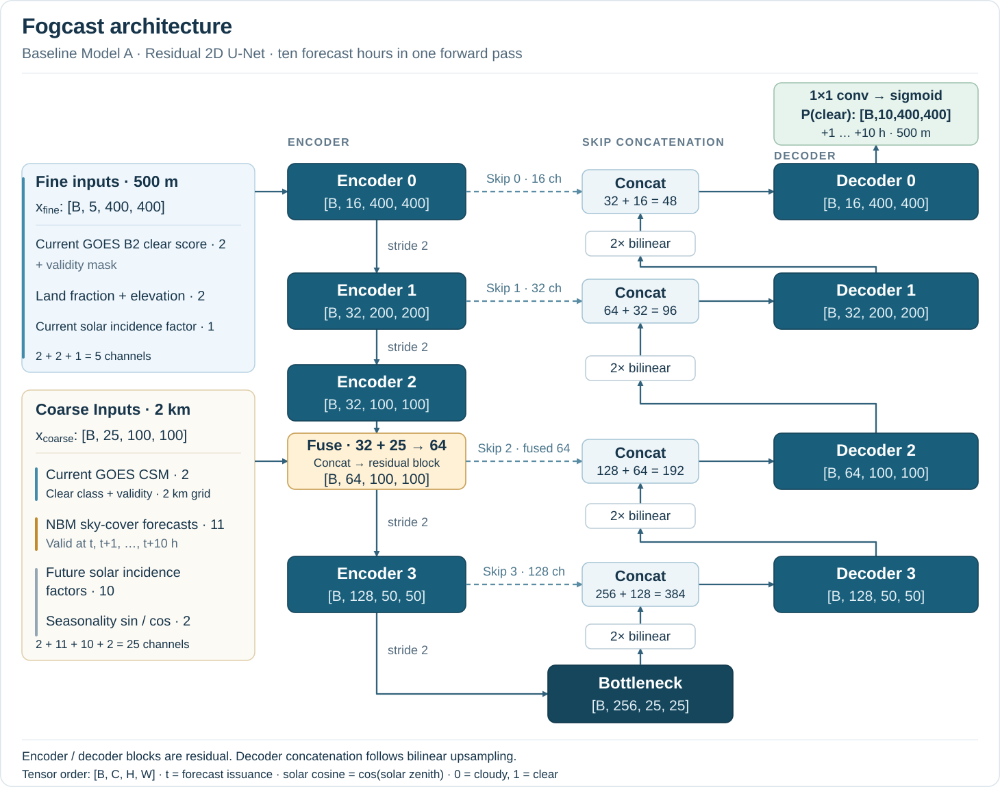

# Fogcast

**High-resolution, machine learning-based clear-sky forecasting for the San Francisco Bay Area using satellite imagery and numerical weather predictions.**

*Status: Work in progress. This repository contains selected implementations and documentation.*

## Motivation

For anyone who's spent time in San Francisco, fog is a force to be reckoned with. It might be 75°F and sunny in Dogpatch, but 60°F and foggy at Ocean Beach. Cloud cover and temperature can vary dramatically across the city.

When planning weekend outings, I've therefore become a regular visitor to [fog.today](https://fog.today/), which displays recent satellite imagery that can be replayed to watch the fog evolve. However, I couldn't find a tool providing similarly detailed forecasts of where and when the fog would clear.

That's what motivated Fogcast: a machine learning-based system designed to predict clear-sky conditions across the San Francisco Bay Area, on a 500 m grid, for the next 10 hours.

## Approach

One of the main challenges is obtaining sufficiently frequent, high-resolution training targets that indicate whether the sky is clear or cloudy at a given location and time.

Existing satellite products involve trade-offs between spatial resolution, temporal coverage, and reliability. For example:

- **GOES Clear Sky Mask (CSM):** Available at 2 km resolution, with frequent observations throughout the day and night.
- **NASA VIIRS cloud mask:** Available at 375 m resolution during the daytime, but with much less frequent coverage of a given location and some classification issues observed in coastal regions.

To obtain high-resolution daytime training targets, I developed a method to infer clear-sky conditions directly from GOES Advanced Baseline Imager Band 2 (B2), which has a native spatial resolution of 500 m. This involved generating a reference for the satellite reflectance expected under clear skies and comparing observations against it.

The forecasting model combines several sources of information:

- **Satellite observations:** Current GOES B2-derived clear-sky mask and GOES CSM.
- **Numerical weather predictions:** NOAA National Blend of Models (NBM) total cloud cover (TCDC) forecasts, providing large-scale meteorological guidance.
- **Geographic information:** Land fraction and elevation.
- **Solar geometry and seasonality:** Information describing the changing illumination conditions and time of year.

During training, daytime predictions are supervised using the high-resolution clear-sky mask derived from future GOES B2 observations. At night, predictions are supervised at the coarser resolution of GOES CSM.

The objective is to combine the spatial detail of satellite observations with the predictive information contained in numerical weather forecasts.

## Model Architecture

The baseline forecasting model uses a **residual U-Net**, a multi-scale convolutional neural network.

We selected this architecture because cloud patterns exhibit spatial structure across multiple scales. Local features can help identify cloud boundaries and coastal effects, while larger-scale features can provide information about regional cloud patterns.

The model uses an encoder-decoder architecture with skip connections to preserve spatial detail. Residual connections within convolutional blocks are added to facilitate network optimization.

Five fine-resolution input channels pass through the encoder, while 25 additional conditioning channels, including NBM forecasts, are introduced at an intermediate 2 km feature resolution.

The model produces ten clear-sky probability maps in a single forward pass, corresponding to forecast horizons of +1 through +10 hours. Each output is defined on a 400 × 400 grid with 500 m spacing, covering a 200 × 200 km region.

*Figure 1. Baseline Fogcast architecture. Five fine-resolution input channels pass through the encoder and are fused with 25 additional coarse-resolution input channels at the 2 km feature level. These additional channels provide satellite observations, NBM forecasts, and solar/seasonal information.*

## Selected technical components

Links to the implementations and brief explanations of the important design choices.

## Results

Representative predictions compared with observations, persistence, and NBM, with quantitative results where available.

## Reproduction

Dependencies and instructions for running the published examples.

## Project status

Active research project; selected components released.

Also insert links to the Fogcast blog posts.