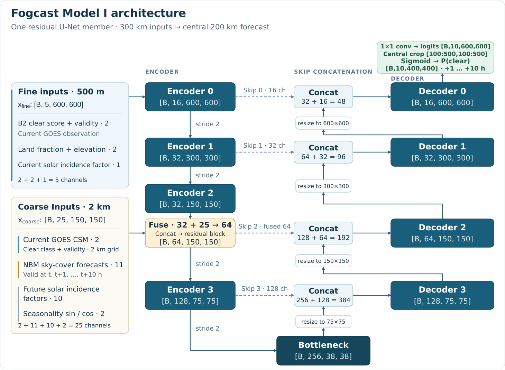

# Fogcast

**Clear-sky forecasting for the San Francisco Bay Area using satellite imagery
and numerical weather predictions.**

Fogcast predicts the probability of clear skies for the next ten hours on a
500 m grid. This package includes the **Model I three-seed blend** used for
current forecasts on [fogcast.today](https://fogcast.today), with two runnable
examples: a historical forecast and a forecast using current NOAA data.

## Motivation

For anyone who's spent time in San Francisco, fog is a force to be reckoned with.
It might be 75°F and sunny in Dogpatch, but 60°F and foggy at Ocean Beach.
Conditions can change dramatically over a short distance.

When planning weekend outings, I've become a regular visitor to
[fog.today](https://fog.today/), which displays recent satellite imagery that
can be replayed to watch the fog evolve. I wanted similarly detailed forecasts
of where and when the fog would clear. That motivated Fogcast: combining the
spatial detail of satellite observations with the predictive information in
numerical weather forecasts.

## Install and run

Use **Python 3.11 or newer**, preferably in a new virtual environment. Run these
commands from the folder containing `pyproject.toml`:

```bash
python -m pip install ".[live]"
python examples/historical.py
python examples/current.py
```

The trained weights, fixed preprocessing arrays, and historical inputs are
included in `assets/`. The examples run on CPU and require no training, API keys,
accounts, or paid services. The current forecast requires internet access.

### Historical forecast

```bash
python examples/historical.py
```

This issues a forecast for **June 14, 2026, at 7:00 a.m. PDT (14:00 UTC)**.
The ten forecast hours run from 8:00 a.m. to 5:00 p.m. PDT, matching the date and
issue time of the website's historical example. This rerun uses the three-seed
blend; the website's retained original June 14 snapshot was generated with seed 42.

The supplied inputs are actual prepared satellite and NBM data for that issue.
Once the package and model assets are present, this example works offline.

Open `outputs/historical/forecast.png` to see all ten forecast maps.

### Current forecast

```bash
python examples/current.py
```

This fetches current GOES-18 visible-band and cloud-mask observations and NOAA
National Blend of Models (NBM) cloud-cover forecasts from the internet. It uses
the current whole UTC hour as its issue time and predicts the following ten hours.

The example stores downloaded NBM files in `outputs/cache/nbm/` inside the
project. Use `--cache-dir` to choose another location.

Open `outputs/current/forecast.png` to see the forecast. If NOAA inputs are
unavailable, the command explains the failure.

## Understanding the outputs

Each example writes four files:

- `forecast.png`: ten north-up maps styled like fogcast.today, with a dark
  geographic basemap, pale semi-transparent clouds, and place labels above the
  clouds. Headings show Pacific times, with UTC times below.
- `forecast.npz`: ten `clear_probability` arrays, shape `[10, 400, 400]`, plus
  coordinates and UTC issue/valid times. Probabilities range from 0 (cloudy) to 1
  (clear). Arrays are stored south-up.
- `inputs.npz`: the prepared inputs, saved for offline replay.
- `forecast.json`: model identity, source records, support counts, and checksums.

Results are saved under `outputs/historical/` or `outputs/current/`, depending
on the example. Probabilities describe clear versus cloudy conditions; the
model does not separately identify fog types. The 500 m grid spacing does not
establish the effective resolution of the forecast.

The PNG uses the website's binary cloud display: a pixel is clear when its
predicted clear-sky probability is at least 50%; otherwise a cloud layer is drawn
at approximately 61% opacity. The NPZ retains the original continuous probabilities.
The small map backgrounds are included in the installed package, so rendering
requires no map downloads. Map attribution appears at the bottom of each PNG;
source details are in [the map notice](src/fogcast/residual_unet_fogcast/data/NOTICE.md).

Choose a new output directory when rerunning an example:

```bash
python examples/current.py --output outputs/another-current-run
```

Both examples also accept `--assets`, `--threads`, `--timeout-seconds`,
`--maximum-download-mib`, and `--cache-dir`. Downloads default to a 128 MiB
response-byte allowance and a 600-second deadline. Use a new cache directory if
the 256 MiB NBM working-cache limit is reached.

## How it works

One challenge is obtaining frequent, detailed training labels indicating whether
the sky is clear or cloudy. GOES Clear Sky Mask (CSM) provides observations on a
2 km grid during both day and night. For daytime detail, Fogcast derives clear-sky
scores from GOES Advanced Baseline Imager Band 2 (B2) observations on a 500 m grid,
comparing observed reflectance with a fitted clear-sky reference.

The forecast combines:

- **Satellite observations:** the current B2-derived clear-sky score, CSM, and
  masks identifying valid observations.
- **Weather forecasts:** NBM total cloud cover from the issue time through +10h.
- **Geography:** land fraction and elevation.
- **Time and illumination:** solar geometry and seasonal information.

During training, B2-derived labels provide fine supervision during daylight.
Native CSM footprints provide coarse supervision when the entire forecast area
has solar zenith angles above 82°. One source is selected for each sample and
forecast target hour.

### Model architecture

Each Model I member is a **residual U-Net**. It processes cloud patterns at
several spatial scales, with skip connections carrying spatial detail through
the encoder and decoder and residual connections helping optimization.

| Arrays | Shape per sample | Grid spacing | Area covered |
| --- | --- | --- | --- |
| Fine inputs | `[5, 600, 600]` | 500 m | 300 × 300 km |
| Weather/context inputs | `[25, 150, 150]` | 2 km | 300 × 300 km |
| Forecast probabilities | `[10, 400, 400]` | 500 m | Central 200 × 200 km |

The 25 conditioning channels enter at an intermediate encoder level. Each member
predicts all ten hours in one forward pass, retaining the central 400 × 400 output
and using the surrounding input area as context.



*Figure 1. One Model I member (above) and the three-seed blend (below). Expanded
600 × 600 inputs provide a 50 km context margin around the central 400 × 400
forecast. Each decoder step resizes to its skip connection's exact grid. Each
member's cropped logits pass through sigmoid before their probabilities are
averaged. [PNG version](docs/architecture/residual_unet_fogcast_architecture.png).*

The blend averages the three members' sigmoid probabilities with equal weights,
accumulating in float64 and returning float32. Selected seeds/epochs are
**42/21, 43/30, and 44/28**. Model and preprocessing files are checked against
the accompanying SHA-256 manifest.

The public preprocessing uses minute-truncated UTC timestamps and leap-year-aware
seasonal calculations. Preprocessing coefficients and neural-network weights are
frozen; running an example performs no fitting.

### Current input availability

Satellite scans must have completed and been created by the issue time, with a
midpoint no more than 20 minutes earlier. CSM observations are required. Missing
or fully dark visible-band observations use a neutral score and an invalid mask.
NBM uses one complete cycle initialized 2–4 hours before the issue time.

## Run the tests

Install the test dependencies and run the checks from the package folder:

```bash
python -m pip install ".[dev,live]"
python -m pip check
python -m pytest -q
```

The tests check input/output shapes, fine and coarse supervision, losses and
gradients, three-member probability averaging, source handling, and example
execution. They use controlled test inputs and run on CPU without live weather
downloads. Running `examples/current.py` separately checks actual NOAA retrieval.

For development, use `python -m pip install -e ".[dev,live]"` so source edits
are reflected without reinstalling the package.

## Project status and further reading

Fogcast is an active research project. This release includes selected model and
preprocessing implementations, trained inference assets, tests, and the two
examples above. Explore forecasts at [fogcast.today](https://fogcast.today).

Five source modules contain the implementation:

| File | Purpose |
| --- | --- |
| [model.py](src/fogcast/residual_unet_fogcast/model.py) | Residual U-Net architecture and central output crop |
| [dataset.py](src/fogcast/residual_unet_fogcast/dataset.py) | Solar geometry, visible-band processing, inputs, targets and collation |
| [losses.py](src/fogcast/residual_unet_fogcast/losses.py) | Fine/native supervision, pooling, BCE and Brier statistics |
| [sources.py](src/fogcast/residual_unet_fogcast/sources.py) | NOAA discovery, downloads, projection and GRIB decoding |
| [forecast.py](src/fogcast/residual_unet_fogcast/forecast.py) | Three-member loading, prediction, output files and CLI |

[CHANGES.xlsx](CHANGES.xlsx) records the file/function inventory, asset checksums,
and validation evidence from preparation of this public package.
